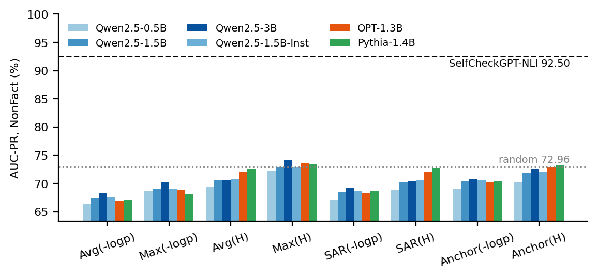
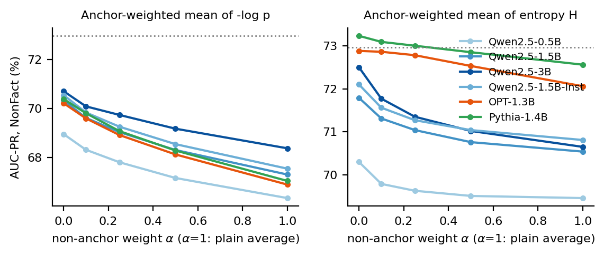
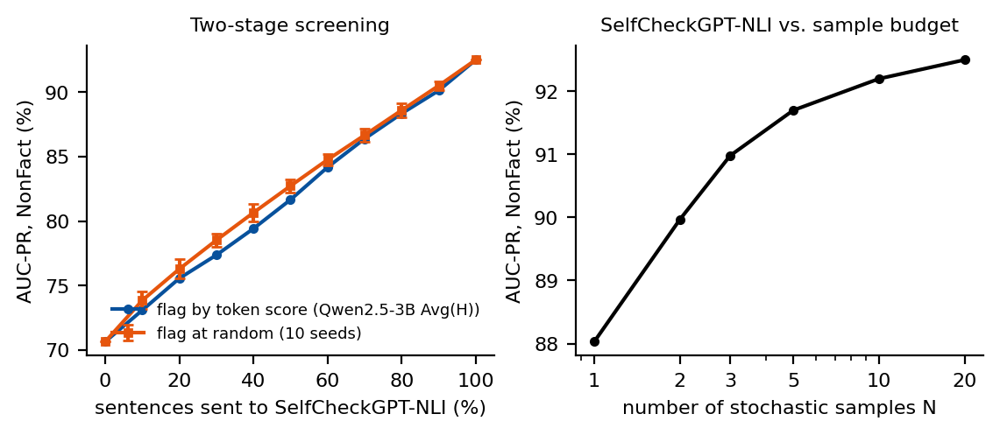
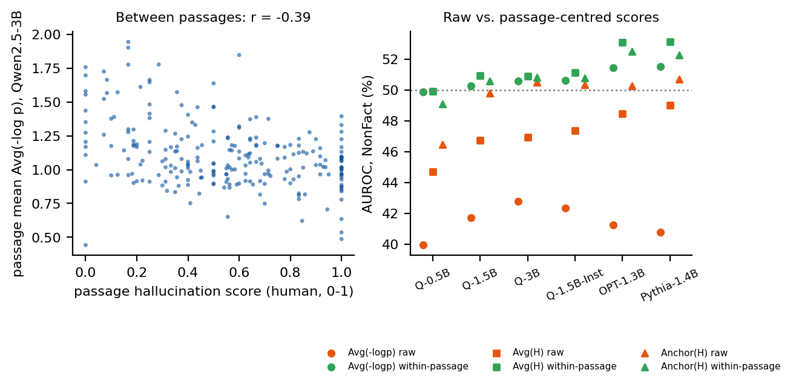

# Proxy Token-Level Uncertainty for Hallucination Detection

**Do small proxy models know when GPT-3 hallucinates?** This is an implementation study that tests two ideas from my
literature review on **token-level uncertainty as a predictor of hallucination in Large Language Models (LLMs)**:
**semantic-anchor weighting** and **two-stage screening**. Everything runs on one free Google Colab T4 GPU, and every
number comes from logged code output.

*AI Tools for Research, Lab 02 · Aman Bhagat (MCL2026013) · IIIT Allahabad*

**[Read the paper (PDF)](paper/main.pdf)** · **[LaTeX source](paper/main.tex)** ·
**[Notebook](notebooks/AITR_Lab02_TokenUQ_Hallucination.ipynb)** ·
[](https://colab.research.google.com/github/Aman-Bhagat-Ai/Proxy-token-uncertainty-hallucination_LLM/blob/main/notebooks/AITR_Lab02_TokenUQ_Hallucination.ipynb) ·
Companion literature review: **[Awesome-token-level-uncertainty_LLM](https://github.com/Aman-Bhagat-Ai/Awesome-token-level-uncertainty_LLM)**

---

## Contents
- [Overview](#overview)
- [Key Results](#key-results)
- [Research Paper](#research-paper)
- [From Review to Experiment (18-prompt record)](#from-review-to-experiment-18-prompt-record)
- [Repository Layout](#repository-layout)
- [Setup](#setup)
- [Data](#data)
- [Reproduce](#reproduce)
- [Results and Figures](#results-and-figures)
- [Validation and Integrity](#validation-and-integrity)
- [Key Sources](#key-sources)
- [Limitations](#limitations)
- [Citation](#citation)
- [License](#license)

---

## Overview
My review concluded that token probabilities are a *real but partial* hallucination signal, and it proposed two
untested ideas:

1. **Semantic-anchor weighting** (review §8.2): average uncertainty only over names, numbers and dates.
2. **Two-stage screening** (review §8.3): a cheap token score decides which sentences get an expensive semantic check.

Both are tested here in the realistic **black-box** setting, where the generator's own probabilities are unavailable
and must be estimated by small open **proxy** LMs (Qwen2.5 0.5B–3B, OPT-1.3B, Pythia-1.4B).

| | Research question |
|---|---|
| **RQ1** | How well do proxy-LM token scores detect non-factual sentences? |
| **RQ2** | Does anchor weighting, or SAR relevance weighting, beat the plain average? |
| **RQ3** | Does a token-score cascade beat random routing to SelfCheckGPT-NLI? |

## Key Results
| | NonFact AUC-PR |
|---|---|
| Random baseline (reproduced exactly) | 72.96 |
| SelfCheckGPT-NLI, N=20 (reproduced; published 92.50) | **92.50** |
| Best proxy score (Qwen2.5-3B Max(H)) | 74.19 |
| Proxy Avg(−log p), 6 proxies | 66.3 – 68.4 (AUROC 40–43, i.e. **inverted**) |
| Anchor − Avg (−log p), paired bootstrap | +2.3 to +3.3, all CIs > 0, but the gain comes from cancelling the inversion |
| Cascade vs. random routing | 0.25–1.24 points *worse* at every budget |

**Takeaway:** small proxy LMs find hallucinated GPT-3 biographies *easier* to predict. The effect lies **between**
passages: after centring each sentence on its passage mean, AUROC is 48–53 for every proxy. If cost matters, use
SelfCheckGPT-NLI with 3–5 samples (90.98–91.70 AUC-PR) rather than a proxy-token screen.

## Research Paper
- **[paper/main.pdf](paper/main.pdf)**: the final manuscript (ACM `acmart`, acmsmall)
- **[paper/main.tex](paper/main.tex)** · **[paper/references.bib](paper/references.bib)** · **[paper/figures/](paper/figures)**

Where each research question is answered in the paper:

| Question | Paper section | Table / figure | Raw file |
|---|---|---|---|
| Baseline validation | §4 | Table 1 | [results/validation.json](results/validation.json) |
| RQ1 | §5.1 | Table 2, Fig. 1, Table 3 | [results/main_table.csv](results/main_table.csv) |
| RQ2 | §5.2 | Table 4, Fig. 2 | [results/bootstrap_ci.csv](results/bootstrap_ci.csv), [results/alpha_sensitivity.csv](results/alpha_sensitivity.csv) |
| RQ3 | §5.3 | Fig. 3 | [results/cascade.csv](results/cascade.csv), [results/nli_n_sensitivity.csv](results/nli_n_sensitivity.csv) |
| Error analysis | §6 | Fig. 4 | [results/diagnostics_direction.csv](results/diagnostics_direction.csv), [results/error_analysis.csv](results/error_analysis.csv) |

## From Review to Experiment (18-prompt record)
The lab handout's 18 prompts were followed, and each one's output is saved. Full index: **[docs/README.md](docs/README.md)**
- **[Original Prompt 01–02 record (22 Oct 2026)](docs/prompts_01_02_original_2026-10-22.pdf)** · [Review scope](docs/01_review_scope.md) · [Gap matrix](docs/02_gap_matrix.md)
- [Literature → experiment map](docs/03_literature_to_experiment_map.md) · [Feasibility and novelty](docs/04_feasibility_novelty_matrix.md) · [Research brief (G1)](docs/research_brief.md)
- [Frozen protocol and flowchart](docs/07_frozen_protocol.md) · [configs/experiment.yaml](configs/experiment.yaml) · [Prompt-to-code log](docs/09_prompt_to_code_log.md)
- [Baseline validation](baseline_validation.md) · [Results and discussion outline](docs/14_results_discussion_outline.md) · [Peer review and revision log](docs/16_peer_review_and_revision_log.md)
- [Decision log (D1–D12)](research_decisions.md) · [AI-assistance and integrity log](ai_assistance_log.md)

## Repository Layout
```
configs/experiment.yaml      frozen protocol (models, metric, alpha, cascade, seeds)
src/tuq/                     data.py, proxy.py, relevance.py, selfcheck.py, aggregate.py, metrics.py
scripts/01..07_*.py          pipeline entry points; run_all.sh runs everything
notebooks/                   the Colab notebook that produced the results
tests/                       synthetic smoke test of the CPU pipeline
results/                     real outputs: logs/, sentence_scores.csv, main_table.csv, bootstrap_ci.csv, cascade.csv, ...
paper/                       main.tex, references.bib, figures/, main.pdf
docs/                        per-prompt records (index: docs/README.md), research brief, peer review
research_decisions.md        decision log (D1–D12)
baseline_validation.md       reproduction checks and deviations
ai_assistance_log.md         AI-use and integrity log
```

## Setup
Tested on **Google Colab, Tesla T4 16 GB, Python 3.13.16**. The exact versions are in [requirements.txt](requirements.txt).
```bash
pip install -r requirements.txt
python -m spacy download en_core_web_sm
```
No API keys are needed. Models and the dataset are downloaded from the Hugging Face Hub on first use.

## Data
[`potsawee/wiki_bio_gpt3_hallucination`](https://huggingface.co/datasets/potsawee/wiki_bio_gpt3_hallucination)
(CC-BY-SA-3.0): 238 GPT-3 biographies, 1,908 human-labelled sentences and 20 samples per passage. See
[data/README.md](data/README.md). The raw data is not committed; step 01 downloads it.

## Reproduce
```bash
bash scripts/run_all.sh        # ≈ 30 min on a T4; every step writes a log to results/logs/
```
| Step | Command | Output | Executed |
|---|---|---|---|
| 01 | `python scripts/01_prepare_data.py` | `data/wikibio_prepared.json` | ✅ Colab T4 |
| 02 | `python scripts/02_proxy_scores.py` | `results/proxy/*.json.gz` | ✅ |
| 03 | `python scripts/03_relevance.py` | `results/relevance.json` | ✅ |
| 04 | `python scripts/04_selfcheck_nli.py` | `results/nli.json` | ✅ |
| 04b | `python scripts/04b_nli_reference_check.py` | `results/logs/04b_*.json` | ✅ |
| 05 | `python scripts/05_evaluate.py` | all result CSVs | ✅ |
| 07 | `python scripts/07_diagnostics.py` | `results/diagnostics_*.csv` | ✅ |
| 06 | `python scripts/06_figures.py` | `paper/figures/*` | ✅ |
| — | `bash scripts/run_all.sh` as one command | everything | [TEST REQUIRED] (the steps were run cell by cell in the notebook) |
| — | `python tests/synthetic_smoke_test.py` (in a scratch copy) | synthetic data | ✅ |

Seeds: model passes are deterministic (no sampling); bootstrap seed 0; random-routing seeds 0–9.

**Minimum reproduction checklist (for a second student):**
1. Open a Colab T4 runtime and clone this repository.
2. Run steps 01–04 and check that `results/validation.json` gives random 72.96 and NLI 92.50.
3. Run 05 → 07 → 06 and diff `results/main_table.csv` against the committed version (small fp16 differences are possible).

## Results and Figures
| Main comparison | Anchor-weight ablation |
|---|---|
|  |  |
| **Cascade and NLI sample count** | **Passage-level diagnosis** |
|  |  |

## Validation and Integrity
- The random baseline is reproduced **exactly** and SelfCheckGPT-NLI **to within 0.01 AUC-PR**: **[baseline_validation.md](baseline_validation.md)**
- The protocol was frozen before any metric was computed; every later change is logged: **[research_decisions.md](research_decisions.md)**
- AI assistance (Claude, Anthropic) is disclosed step by step, with how each step was checked: **[ai_assistance_log.md](ai_assistance_log.md)**

## Key Sources
- **SelfCheckGPT**, Manakul et al., EMNLP 2023 · **Link:** https://doi.org/10.18653/v1/2023.emnlp-main.557
- **SAR (Shifting Attention to Relevance)**, Duan et al., ACL 2024 · **Link:** https://doi.org/10.18653/v1/2024.acl-long.276
- **Semantic entropy**, Farquhar et al., Nature 2024 · **Link:** https://doi.org/10.1038/s41586-024-07421-0
- **LM-Polygraph**, Vashurin et al., TACL 2025
- **Uncertainty-quantification survey**, Shorinwa et al., ACM Computing Surveys 2025 · **Link:** https://doi.org/10.1145/3744238
- Full bibliography: **[paper/references.bib](paper/references.bib)**

## Limitations
Proxies are ≤ 3B parameters (T4 memory). The study covers one dataset, one domain, one generator and English only. The
step-07 diagnostics are exploratory (decision D9). None of the results apply to the **white-box** case, where the
generator's own probabilities are available.

## Citation
```bibtex
@misc{bhagat2026proxy,
  author = {Bhagat, Aman},
  title  = {Do Small Proxy Models Know When GPT-3 Hallucinates? Token-Level Uncertainty, Semantic-Anchor Weighting and Two-Stage Screening},
  year   = {2026},
  note   = {IIIT Allahabad, AI Tools for Research, Lab 02},
  howpublished = {\url{https://github.com/Aman-Bhagat-Ai/Proxy-token-uncertainty-hallucination_LLM}}
}
```

## License
Code: [MIT](LICENSE). Dataset and models keep their own licenses (see their Hugging Face cards).

---
*Part of my token-level uncertainty series → literature review: [Awesome-token-level-uncertainty_LLM](https://github.com/Aman-Bhagat-Ai/Awesome-token-level-uncertainty_LLM)*
