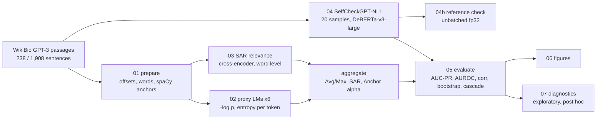

# Prompt 07: frozen evaluation protocol, flowchart and pre-experiment checklist

The machine-readable protocol is [`../configs/experiment.yaml`](../configs/experiment.yaml). It was written before any
metric was computed (D5). This page explains it.

## Inputs and outputs
* **Input:** 238 GPT-3 passages, 1,908 sentences with human labels (accurate / minor / major), and 20 GPT-3 samples per passage.
* **Output per sentence:** proxy scores (Avg/Max of −log p and H; SAR-weighted; anchor-weighted for α ∈ {0, .1, .25, .5, 1}) and the SelfCheckGPT-NLI score for N ∈ {1, 2, 3, 5, 10, 20}.

## Flowchart

## Fixed settings
| Item | Value |
|---|---|
| Partition | The single `evaluation` split, used only as a test set. Nothing is trained or tuned. |
| Primary metric | NonFact AUC-PR (higher is better), `precision_recall_curve` + trapezoidal `auc`, as in SelfCheckGPT |
| Secondary metrics | NonFact* and Factual AUC-PR, AUROC, passage Pearson/Spearman (all higher is better) |
| Primary modification | Anchor weighting with α = 0 |
| Cascade stage 1 | Qwen2.5-3B Avg(H), fixed in advance; random control with seeds 0–9 |
| Uncertainty | 1,000 passage-level bootstrap resamples, seed 0; paired differences on the same resamples |
| Determinism | fp16 forward passes, no sampling |
| Budget | One T4; proxies ≤ 3B |
| Deeper analyses | α ablation (sensitivity), N-sensitivity (efficiency), cascade cost curve, error analysis by subset |
| Expected outputs | Main table (models × scores), paired-difference table, α figure, cascade/N figure |

## Pre-experiment checklist (completed before step 05)
- [x] Primary metric and its direction frozen in the YAML
- [x] Test split fixed (the only split; no tuning)
- [x] Comparison protocol fixed: same sentences, same prefix and same token-to-sentence mapping for every proxy
- [x] Cascade selector chosen without looking at labels
- [x] Random baseline reproduces 72.96 / 29.72 / 27.04 (label pipeline correct)
- [x] NLI reproduces 92.50 (model pipeline correct)

## Threats to validity (see paper §Discussion)
* Construct: one generator, one domain, AUC-PR depends on the 73 % base rate.
* Internal: the prefix and tagger were not varied; word-level SAR is a deviation from token-level SAR.
* External: proxies ≤ 3B.
* Statistical: 238 passages, so single-score CIs are wide.

## How protocol changes are logged
Any change after freezing gets a dated row in [`../research_decisions.md`](../research_decisions.md) with its reason
and whether metrics had been seen. Logged changes:
* **D7**: two proxies added before any metric was computed.
* **D9**: exploratory diagnostics added after seeing the results and labelled post hoc.
* **D10**: equivalence check re-implemented.
* **D11**: the threshold-transfer analysis is reported as uninformative.
